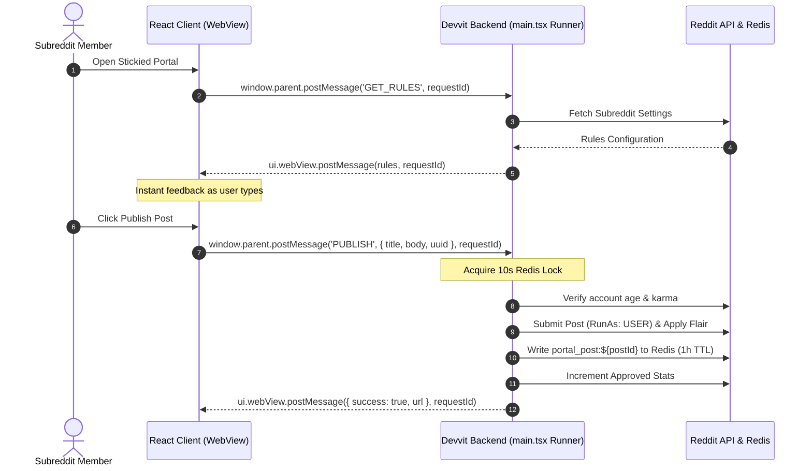

<p align="center">
  
</p>

<h1 align="center">PostPilot</h1>

<p align="center">
  <strong>Reddit Devvit Interactive Posting Portal, Pre-Submission Rule Validator, &amp; Automated Mod Enforcer.</strong>
</p>

<p align="center">
  
  
  
  
  <a href="future.md"></a>
</p>

---

## ⚡ Overview

**PostPilot** transforms Reddit community onboarding and quality assurance by replacing standard Reddit submission boxes with an interactive, rich-client posting portal pinned to the top of the subreddit:

- **⚡ Zero-Latency Client Validation**: Real-time validation checklist (title regex, word counts, blacklist) matches subreddit rules as the user types.
- **🛡️ Digital Fortress Backend**: Secondary server-side validation in `main.tsx` checks account age and karma to prevent API spoofing.
- **🔒 Redis NX Idempotency Lock**: A 10-second submission lock eliminates duplicate posts under flaky connections.
- **🤖 Fallback Enforcer Trigger**: A background `PostSubmit` hook instantly quarantines native posts that bypass the portal, replying with an official mod warning.
- **📊 Moderator Telemetry Hub**: Private dashboard for moderators to view approved posts, block rates, and enforcer bypass counts.
- **✍️ Live Markdown Preview**: Custom lightweight parser renders rich text drafts instantly without heavy external dependencies.
- **🔋 Clipboard Pasteurizer**: Intercepts rich text/HTML paste events to strip binary media and prevent large payloads from breaching Devvit's 4MB limit.

---

## 🏗️ Architecture Flow



---

## ⚙️ Configuration Schema

PostPilot rules are defined declaratively in the `devvit.json` settings schema:

| Setting Key | Type | Description |
| :--- | :--- | :--- |
| `title_regex` | `string` | Regex pattern that post titles must match (e.g., `^\[[a-zA-Z]+\].*$` for bracket tags). |
| `min_body` | `number` | Minimum character length for post markdown text. |
| `flair_id` | `string` | Reddit Flair Template UUID applied automatically upon publication. |
| `keyword_blacklist` | `string` | Comma-separated list of forbidden keywords (e.g. `crypto,scam,spam`). |
| `minimum_account_age` | `number` | Minimum age of the posting user's account in days. |
| `minimum_karma` | `number` | Minimum combined (link + comment) karma of the posting user. |
| `enforcer` | `boolean` | Global toggle to enable/disable the native post bypass enforcer. |

---

## 🚀 Installation & Deployment

### 1. Prerequisites
Ensure you are logged into your Reddit account via the CLI:
```bash
npx devvit login
```

### 2. Scaffold and Build
Install local dependencies and compile the React frontend assets:
```bash
npm install
npm run build
```

### 3. Playtesting (Local Development)
To test and verify changes instantly on your test subreddit before publishing:
```bash
npx devvit playtest <your-test-subreddit>
```

### 4. Publish to Registry
When ready to release your version to the Devvit App Directory, run:
```bash
npx devvit publish
```

### 5. Subreddit Installation
Install the published application on your subreddit:
```bash
npx devvit install <your-subreddit-name>
```

---

## 🧪 Testing Suite

PostPilot features a comprehensive testing system utilizing **Vitest** to isolate and mock Devvit plugins (Redis, Reddit API, and Subreddit Settings).

To execute the test suite:
```bash
npm test
```

---

## 🔮 Engineering Roadmap

To explore planned features including client-side Wasm image compression, on-device ONNX toxicity classification, and cross-subreddit shared moderation federation, read [future.md](future.md).

---

## 📄 License

Distributed under the MIT License.
